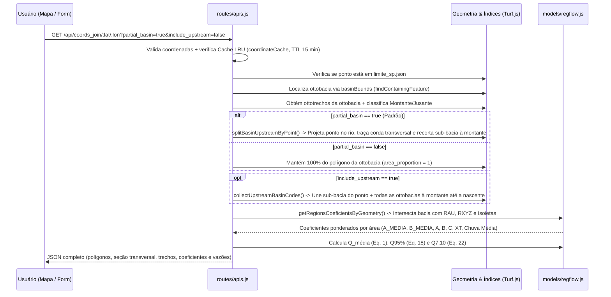

# Arquitetura do Sistema — SP-ÁGUAS | REG-FLOW

Este documento descreve em profundidade a arquitetura técnica, o modelo de dados geoespaciais em memória, o fluxo de requisições, os mecanismos de segurança e o estado de interface do **REG-FLOW**.

---

## 1. Visão Geral da Arquitetura

O **REG-FLOW** é uma aplicação web monolítica e *stateless* construída sobre **Node.js 24.x** e **Express 4**, projetada para executar análises geoespaciais e hidrológicas de baixa latência inteiramente em memória (sem dependência de banco de dados externo em tempo de execução) utilizando **Turf.js (`@turf/turf`)**.


---

## 2. Estrutura de Diretórios e Responsabilidades

```text
daee-reg-flow/
├── app.js                         # Configuração Express, headers de segurança (CSP), limites de body (512kb / 60mb)
├── bin/
│   └── www                        # Inicialização do servidor HTTP (porta padrão 3001)
├── models/
│   └── regflow.js                 # Núcleo matemático e geoespacial da metodologia DAEE (1988)
├── routes/
│   ├── index.js                   # Rotas de páginas (GET /, GET /api-docs, GET /api/docs)
│   └── apis.js                    # Endpoints REST (/api/*), índices espaciais, corte transversal e simulações
├── views/
│   ├── index.ejs                  # Aplicação principal (Mapa interativo, Sidebar colapsável, Modais de simulação)
│   ├── api-docs.ejs               # Página interativa do Swagger UI (/api-docs)
│   └── error.ejs                  # Template de erro HTTP
├── public/
│   ├── openapi.json               # Especificação completa OpenAPI 3.0.3 publicada pelo sistema
│   ├── stylesheets/
│   │   └── style.css              # Folha de estilos única (layout responsivo, painéis colapsáveis, modais)
│   ├── images/                    # Identidade visual institucional (SP-ÁGUAS)
│   └── layers/                    # Base cartográfica oficial em GeoJSON (carregada na inicialização)
│       ├── limite_sp.json         # Polígono do limite estadual de São Paulo
│       ├── municipios_sp.json     # Polígonos dos 645 municípios paulistas
│       ├── ottobacias_sp.json     # Polígonos das ottobacias hidrográficas (COBACIA)
│       ├── ottotrechos_sp.json    # Rede de drenagem (COBACIA, COBACIAJUS, NOCOMPLETO, NUCOMPTREC)
│       ├── rain_isoline.json      # Faixas de isoietas médias anuais históricas (propriedade ID em mm)
│       ├── rau.json               # Polígonos das 21 regiões hidrológicas homogêneas (A a U)
│       └── rxyz.json              # Polígonos das 3 regiões do parâmetro C de 7 dias (X, Y, Z)
├── docs/                          # Documentação técnica e guia para IA / Vibecoding
│   ├── ARCHITECTURE.md            # Este documento (arquitetura detalhada)
│   ├── METHODOLOGY.md             # Metodologia hidrológica DAEE (1988) e algoritmos geométricos
│   ├── API_REFERENCE.md           # Guia detalhado dos endpoints REST e exemplos
│   └── VIBECODING_GUIDE.md        # Guia de contexto e receitas para desenvolvimento assistido por IA
├── AGENTS.md                      # Instruções diretas para agentes de codificação (Cursor, Claude, Antigravity, Copilot)
└── test/
    ├── api.test.js                # Testes de integração HTTP de todas as rotas da API e interface
    └── regflow.test.js            # Testes unitários determinísticos das equações hidrológicas e ponderações
```

---

## 3. Indexação Espacial em Memória (`routes/apis.js`)

Na inicialização do processo Node.js, `routes/apis.js` pré-processa as camadas GeoJSON para evitar varreduras lineares custosas a cada requisição:

1. **`basinBounds` (`buildBoundsIndex(ottobacias_json)`)**:
   - Pré-calcula o *bounding box* `[minX, minY, maxX, maxY]` de cada ottobacia.
   - Na função `findContainingFeature(basinBounds, point, lon, lat)`, o teste caro de ponto-em-polígono (`turf.booleanPointInPolygon`) só é executado nas feições cujo *bounding box* contém `(lon, lat)`, reduzindo o tempo de busca de centenas de milissegundos para `< 1 ms`.
2. **`ottobaciasByCode` (`Map<string, Feature>`)**:
   - Indexa cada ottobacia por `String(feature.properties.COBACIA)` em $O(1)$, essencial para montar a árvore de bacias à montante.
3. **`ottotrechosByBasin` (`Object<string, Feature[]>`)**:
   - Agrupa os segmentos de curso d'água (`ottotrechos_sp.json`) pelo código `COBACIA` em $O(1)$.
4. **`upstreamBasinsByDownstream` (`Map<string, Set<string>>`)**:
   - Grafo direcionado reverso construído a partir dos atributos `COBACIA` (bacia atual) e `COBACIAJUS` (bacia imediatamente à jusante) dos ottotrechos.
   - Permite que `collectUpstreamBasinCodes(startCode)` percorra em busca em largura (BFS) todas as ottobacias tributárias à montante até as cabeceiras em menos de `1 ms`, com proteção contra ciclos (`visited`).

---

## 4. Pipeline de Consulta por Coordenadas (`GET /api/coords_join/:lat/:lon`)



---

## 5. Segurança, Performance e Resiliência

| Mecanismo | Implementação | Detalhes Técnicos |
| :--- | :--- | :--- |
| **Content Security Policy (CSP)** | `app.js` | Permite scripts/estilos apenas de `'self'`, `'unsafe-inline'` e `https://unpkg.com` (usado por Leaflet, Leaflet-Geoman e Swagger UI), imagens de provedores de tiles oficiais e conexões à API Mapbox. |
| **Suporte a Gzip no Request Body** | `routes/apis.js` (`decompressGzipRequest`) | Navegadores compatíveis comprimem payloads GeoJSON de simulação de isoietas via `CompressionStream('gzip')`. O servidor descomprime em *streaming* com limite estrito de **60 MB descompactados**, prevenindo ataques *zip bomb*. |
| **Limites de Payload JSON** | `app.js` | `512 KB` para rotas padrão e `60 MB` exclusivamente para `/api/isohyet_simulation` e `/api/isohyet_adjust`. |
| **Rate Limiting em Memória** | `routes/apis.js` (`limitCoordinateRequests`) | Limita a **30 requisições por minuto por IP** nas rotas de processamento espacial. Em testes locais (`127.0.0.1` / `::1`) o limitador é ignorado para permitir execução rápida da suíte de testes. |
| **Cache LRU de Coordenadas** | `routes/apis.js` (`coordinateCache`) | Armazena até 500 resultados recentes por chave `(lat, lon, include_upstream, partial_basin)` com TTL de 15 minutos, retornando o header `X-Cache: HIT` ou `MISS`. |
| **Tolerância a Topologias Complexas** | `models/regflow.js` (`intersectPolygonFeatures`) | Quando `turf.intersect` falha devido a autointerseções ou multipolígonos complexos na fronteira estadual, o sistema faz *fallback* automático decompondo as geometrias via `turf.flattenEach` e `turf.unkinkPolygon`, com amostragem por grade de pontos em última instância. |

---

## 6. Arquitetura do Frontend (`views/index.ejs` + `public/stylesheets/style.css`)

A interface principal utiliza HTML5 semântico (`<header>`, `<main class="workspace">`, `<section>`, `<aside>`, `<dialog>`) sem dependência de *bundlers* ou *frameworks* pesados, garantindo carregamento instantâneo:

- **Painel de Consulta (`#search-panel`) e Botão de Restauração (`#restore-search-panel`)**:
  - Permite entrada de coordenadas, ativação/desativação do **Cálculo parcial da bacia (`#partial-basin`)**, ativação de **Bacias à montante até a nascente (`#include-upstream`)**, geolocalização (`#locate-button`) e desenho livre de bacia (`#start-drawing`).
  - Pode ser recolhido pelo botão `#close-search` no canto superior direito do painel e restaurado pelo botão flutuante `#restore-search-panel`.
- **Sidebar de Resultados (`#results-panel`) e Aba Lateral (`#toggle-results-sidebar`)**:
  - Exibe parâmetros fisiográficos, lista de ottobacias à montante ou intersectadas, coeficientes regionais, métricas hidrológicas ($\overline{Q}$, $Q_{95\%}$, $Q_{7,10}$) e gatilhos de simulação.
  - Conta com o botão lateral `#toggle-results-sidebar` na borda direita da tela (com seta que rotaciona conforme o estado aberto/fechado) para colapsar e expandir o painel a qualquer momento.
- **Modo de Visualização Limpa do Mapa (`#toggle-panels-visibility`)**:
  - Botão no cabeçalho superior que oculta simultaneamente os painéis flutuantes (`#search-panel` e `#results-panel`) para inspeção desobstruída do mapa e os restaura com um clique.
- **Modais Nativos (`<dialog>`)**:
  - `#regularization-dialog`: Simulador completo de Volume de Regularização Intra-Anual (Equações 12 a 15 do DAEE), com suporte à vazão calculada da bacia (`value="calculated"`), catálogo regional (`A`–`U`), exemplo do Rio Buquira, memória de cálculo e gráfico vetorial SVG da Figura 4.
  - `#simulation-dialog` + `#isohyet-editor`: Simulador comparativo de até 6 cenários de isoietas e editor cartográfico interativo de faixas de precipitação.

