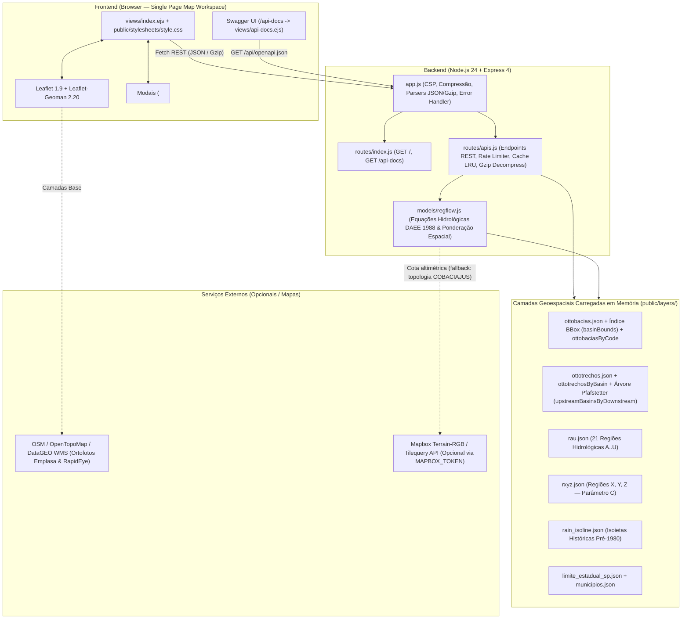
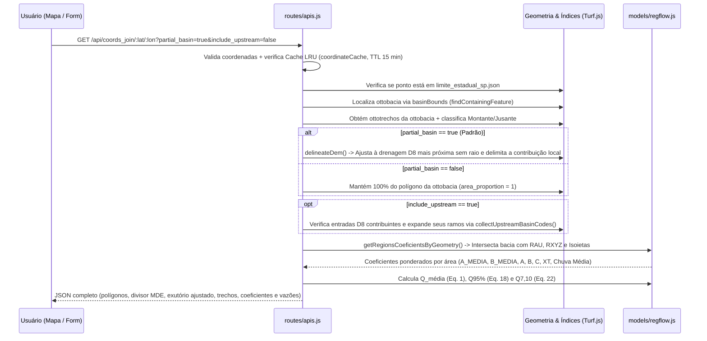

# Arquitetura do Sistema — SP-ÁGUAS | REG-FLOW

Este documento descreve em profundidade a arquitetura técnica, o modelo de dados geoespaciais em memória, o fluxo de requisições, os mecanismos de segurança e o estado de interface do **REG-FLOW**.

---

## 1. Visão Geral da Arquitetura

O **REG-FLOW** é uma aplicação web monolítica e *stateless* construída sobre **Node.js 24.x** e **Express 4**, projetada para executar análises geoespaciais e hidrológicas de baixa latência inteiramente em memória (sem dependência de banco de dados externo em tempo de execução) utilizando **Turf.js (`@turf/turf`)**.



---

## 2. Estrutura de Diretórios e Responsabilidades

```text
daee-reg-flow/
├── app.js                         # Configuração Express, headers de segurança (CSP), limites de body (512kb / 60mb)
├── bin/
│   └── www                        # Inicialização do servidor HTTP (porta padrão 3001)
├── models/
│   └── regflow.js                 # Núcleo matemático e geoespacial da metodologia DAEE (1988)
├── routes/
│   ├── index.js                   # Rotas de páginas (GET /, GET /api-docs, GET /api/docs)
│   └── apis.js                    # Endpoints REST (/api/*), índices espaciais, integração MDE e simulações
├── views/
│   ├── index.ejs                  # Aplicação principal (Mapa interativo, Sidebar colapsável, Modais de simulação)
│   ├── api-docs.ejs               # Página interativa do Swagger UI (/api-docs)
│   └── error.ejs                  # Template de erro HTTP
├── public/
│   ├── openapi.json               # Especificação completa OpenAPI 3.0.3 publicada pelo sistema
│   ├── stylesheets/
│   │   └── style.css              # Folha de estilos única (layout responsivo, painéis colapsáveis, modais)
│   ├── images/                    # Identidade visual institucional (SP-ÁGUAS)
│   └── layers/                    # Base cartográfica oficial em GeoJSON (carregada na inicialização)
│       ├── limite_estadual_sp.json         # Polígono do limite estadual de São Paulo
│       ├── municipios.json     # Polígonos dos 645 municípios paulistas
│       ├── ottobacias.json     # Polígonos das ottobacias hidrográficas (COBACIA)
│       ├── ottotrechos.json    # Rede de drenagem (COBACIA, COBACIAJUS, NOCOMPLETO, NUCOMPTREC)
│       ├── rain_isoline.json      # Faixas de isoietas médias anuais históricas (propriedade ID em mm)
│       ├── rau.json               # Polígonos das 21 regiões hidrológicas homogêneas (A a U)
│       └── rxyz.json              # Polígonos das 3 regiões do parâmetro C de 7 dias (X, Y, Z)
├── docs/                          # Documentação técnica e guia para IA / Vibecoding
│   ├── ARCHITECTURE.md            # Este documento (arquitetura detalhada)
│   ├── METHODOLOGY.md             # Metodologia hidrológica DAEE (1988) e algoritmos geométricos
│   ├── API_REFERENCE.md           # Guia detalhado dos endpoints REST e exemplos
│   └── VIBECODING_GUIDE.md        # Guia de contexto e receitas para desenvolvimento assistido por IA
├── AGENTS.md                      # Instruções diretas para agentes de codificação (Cursor, Claude, Antigravity, Copilot)
└── test/
    ├── api.test.js                # Testes de integração HTTP de todas as rotas da API e interface
    └── regflow.test.js            # Testes unitários determinísticos das equações hidrológicas e ponderações
```

---

## 3. Indexação Espacial em Memória (`routes/apis.js`)

Na inicialização do processo Node.js, `routes/apis.js` pré-processa as camadas GeoJSON para evitar varreduras lineares custosas a cada requisição:

1. **`basinBounds` (`buildBoundsIndex(ottobacias_json)`)**:
   - Pré-calcula o *bounding box* `[minX, minY, maxX, maxY]` de cada ottobacia.
   - Na função `findContainingFeature(basinBounds, point, lon, lat)`, o teste caro de ponto-em-polígono (`turf.booleanPointInPolygon`) só é executado nas feições cujo *bounding box* contém `(lon, lat)`, reduzindo o tempo de busca de centenas de milissegundos para `< 1 ms`.
2. **`ottobaciasByCode` (`Map<string, Feature>`)**:
   - Indexa cada ottobacia por `String(feature.properties.COBACIA)` em $O(1)$, essencial para montar a árvore de bacias à montante.
3. **`ottotrechosByBasin` (`Object<string, Feature[]>`)**:
   - Agrupa os segmentos de curso d'água (`ottotrechos.json`) pelo código `COBACIA` em $O(1)$.
4. **`upstreamBasinsByDownstream` (`Map<string, Set<string>>`)**:
   - Grafo direcionado reverso construído a partir dos atributos `COBACIA` (bacia atual) e `COBACIAJUS` (bacia imediatamente à jusante) dos ottotrechos.
   - Permite que `collectUpstreamBasinCodes(startCode)` percorra em busca em largura (BFS) todas as ottobacias tributárias à montante até as cabeceiras em menos de `1 ms`, com proteção contra ciclos (`visited`).

---

## 4. Pipeline de Consulta por Coordenadas (`GET /api/coords_join/:lat/:lon`)



---

## 5. Segurança, Performance e Resiliência

| Mecanismo | Implementação | Detalhes Técnicos |
| :--- | :--- | :--- |
| **Content Security Policy (CSP)** | `app.js` | Permite scripts/estilos apenas de `'self'`, `'unsafe-inline'` e `https://unpkg.com` (usado por Leaflet, Leaflet-Geoman e Swagger UI), imagens de provedores de tiles oficiais e conexões à API Mapbox. |
| **Suporte a Gzip no Request Body** | `routes/apis.js` (`decompressGzipRequest`) | Navegadores compatíveis comprimem payloads GeoJSON de simulação de isoietas via `CompressionStream('gzip')`. O servidor descomprime em *streaming* com limite estrito de **60 MB descompactados**, prevenindo ataques *zip bomb*. |
| **Limites de Payload JSON** | `app.js` | `512 KB` para rotas padrão e `60 MB` exclusivamente para `/api/isohyet_simulation` e `/api/isohyet_adjust`. |
| **Rate Limiting em Memória** | `routes/apis.js` (`limitCoordinateRequests`) | Limita a **30 requisições por minuto por IP** nas rotas de processamento espacial. Em testes locais (`127.0.0.1` / `::1`) o limitador é ignorado para permitir execução rápida da suíte de testes. |
| **Cache LRU de Coordenadas** | `routes/apis.js` (`coordinateCache`) | Armazena buffers JSON de até 128 resultados, 32 MiB totais e 8 MiB por entrada, por chave de coordenadas e opções com TTL de 15 minutos, retornando o header `X-Cache: HIT` ou `MISS`. |
| **Tolerância a Topologias Complexas** | `models/regflow.js` (`intersectPolygonFeatures`) | Quando `turf.intersect` falha devido a autointerseções ou multipolígonos complexos na fronteira estadual, o sistema faz *fallback* automático decompondo as geometrias via `turf.flattenEach` e `turf.unkinkPolygon`, com amostragem por grade de pontos em última instância. |

---

## 6. Arquitetura do Frontend (`views/index.ejs` + `public/stylesheets/style.css`)

A interface principal utiliza HTML5 semântico (`<header>`, `<main class="workspace">`, `<section>`, `<aside>`, `<dialog>`) sem dependência de *bundlers* ou *frameworks* pesados, garantindo carregamento instantâneo:

- **Painel de Consulta (`#search-panel`) e Botão de Restauração (`#restore-search-panel`)**:
  - Permite entrada de coordenadas, ativação/desativação do **Cálculo parcial da bacia (`#partial-basin`)**, ativação de **Bacias à montante até a nascente (`#include-upstream`)**, geolocalização (`#locate-button`) e desenho livre de bacia (`#start-drawing`).
  - Pode ser recolhido pelo botão `#close-search` no canto superior direito do painel e restaurado pelo botão flutuante `#restore-search-panel`.
- **Sidebar de Resultados (`#results-panel`) e Aba Lateral (`#toggle-results-sidebar`)**:
  - Exibe parâmetros fisiográficos, lista de ottobacias à montante ou intersectadas, coeficientes regionais, métricas hidrológicas ($\overline{Q}$, $Q_{95\%}$, $Q_{7,10}$) e gatilhos de simulação.
  - Conta com o botão lateral `#toggle-results-sidebar` na borda direita da tela (com seta que rotaciona conforme o estado aberto/fechado) para colapsar e expandir o painel a qualquer momento.
- **Modo de Visualização Limpa do Mapa (`#toggle-panels-visibility`)**:
  - Botão no cabeçalho superior que oculta simultaneamente os painéis flutuantes (`#search-panel` e `#results-panel`) para inspeção desobstruída do mapa e os restaura com um clique.
- **Modais Nativos (`<dialog>`)**:
  - `#regularization-dialog`: Simulador completo de Volume de Regularização Intra-Anual (Equações 12 a 15 do DAEE), com suporte à vazão calculada da bacia (`value="calculated"`), catálogo regional (`A`–`U`), exemplo do Rio Buquira, memória de cálculo e gráfico vetorial SVG da Figura 4.
  - `#simulation-dialog` + `#isohyet-editor`: Simulador comparativo de até 6 cenários de isoietas e editor cartográfico interativo de faixas de precipitação.


## Delimitador MDE das consultas parciais

`services/dem-delineation.js` executa `scripts/hydrology/delineate.py` em subprocesso assíncrono, usando rasters D8/acumulação preparados offline por GDAL e GRASS. Os endpoints `/api/coords_join/:lat/:lon` (modo parcial) e `/api/dem_delineation/:lat/:lon` compartilham o delimitador D8 e o rate limit. O cache considera coordenadas exatas, modo e limiar de drenagem; não há fallback para corda reta. Uma tarefa por processo; janela máxima de 4 milhões de células; execução máxima de 8,5 s. Dados derivados em `data/hydrology/` fora da área pública. Consulte [algoritmo, provisionamento e limitações](DEM_DELINEATION.md).

`scripts/hydrology/topography.py` gera o recorte visual da elevação de entrada na mesma tarefa Python. A janela é reduzida e reprojetada para Web Mercator, com máscara e transparência, e retorna PNG em data URI com bounds WGS84 no campo `topography`. O frontend usa `L.imageOverlay` em pane abaixo dos vetores, legenda e opacidade. A imagem é cacheada com a resposta de coordenadas; não há endpoint de leitura arbitrária de arquivos ou recortes persistentes por requisição.

A opção `include_topography` integra a chave do cache. No modo integral, `delineateDem.topography()` executa apenas o CLI de `topography.py`, compartilhando o limite de concorrência do serviço, mas sem carregar direção/acumulação nem executar o grafo D8. Falhas visuais retornam aviso na resposta integral, preservando o cálculo hidrológico.

O método `delineateDem.microbasins()` compartilha o limite de concorrência do serviço Python e chama `microbasins.py`. A API por código de ottobacia usa os índices oficiais existentes. O painel usa `POST /api/microbasins` com a geometria final assinada (recorte e agregação a montante), dissolvida antes da partição para preservar conexões entre ottobacias. Ambas compartilham um cache LRU próprio por hash da geometria, escopo e parâmetros (8 resultados / 16 MB serializados, TTL 15 min, invalidado por tamanho/mtime dos rasters). O frontend adiciona uma camada vetorial de microbacias/residuais e protege respostas obsoletas com AbortController e contador de geração. A visualização não altera o resultado hidrológico da consulta por ponto.

### Hidrografia completa por WMS

O seletor de camadas inclui a sobreposição opcional **Hidrografia completa (DAEE)**, desativada inicialmente. Usa `https://geodados.daee.sp.gov.br/geoserver/wms`, camada `sibh:hidrografia_completa`, WMS 1.3.0, PNG transparente. O Leaflet calcula BBOX e dimensões dos tiles em EPSG:3857 conforme a navegação. A camada fica acima das camadas temáticas e abaixo dos ottotrechos selecionados; não intercepta cliques nem altera cálculos. A política CSP permite imagens e conexões ao domínio oficial. A disponibilidade e o estilo da hidrografia dependem do servidor WMS.

### Consulta de outorgas

`services/water-balance.js` integra WFS oficial por URL fixa, páginas de 500 feições e BBOX CRS:84; a seleção exata usa Turf sobre o polígono final. O backend solicita somente identificadores, tipos, status, volume e vazão (sem dados pessoais do cadastro). Verifica contagem e identificadores sem repetição, com orçamento total de 8 s, máximo 10000 candidatos e 3 MB de resultado. Cache local limitado a quatro resultados de até 2 MB cada, TTL de 5 minutos; resultados falhos não são armazenados. A camada externa é mutável: a verificação não constitui snapshot transacional e alterações exigem nova consulta. A UI usa AbortController e geração de consulta para descartar resultados de uma bacia anterior. O botão não altera o cálculo base ou seu memorial. Detalhes em [WATER_BALANCE.md](WATER_BALANCE.md).

Na consulta por coordenadas, a topografia é renderizada depois de compor a geometria final, abrangendo também as bacias agregadas a montante. O subprocesso visual normaliza polígonos adjacentes e recebe apenas o orçamento de execução restante após D8/agregação. `scope=calculated_basin` distingue essa visualização da ottobacia local do endpoint independente de delimitação.

Ao exibir topografia, o enquadramento do resultado usa `fitBounds` sem animação para manter os vetores e o raster alinhados durante a troca de escala, inclusive em redes agregadas com milhares de curvas.


## Integridade das geometrias, parâmetros e cache

As propriedades recebidas no GeoJSON são metadados: nunca substituem coeficientes oficiais, chuva ou áreas de interseção. Os índices de bounding box do modelo usam WeakMap e não alteram as feições carregadas em memória.

Resultados de cálculo recebem `properties._regflow_geometry_token`, uma assinatura HMAC do tipo e das coordenadas. Ao reenviar uma geometria final intacta, preservar essa propriedade. Somente geometrias oficiais idênticas ou com assinatura válida podem usar as exceções necessárias a bordas oficiais e redes agregadas. `is_upstream_subbasin` e `is_upstream_network` não autorizam exceções. O limite geral é 5.000 posições; resultados verificáveis têm teto de 100.000. Coordenadas finitas WGS84, anéis fechados e área válida são sempre exigidos. `bbox` recebido não é confiável e é descartado.

Definir `GEOMETRY_SIGNING_SECRET` com um segredo forte e igual em todas as réplicas. Se não definido, gera-se chave aleatória por processo. Reiniciar esse processo ou trocar a chave invalida provas anteriores; recalcular a bacia para obter uma nova assinatura. A prova não é autenticação de usuário e não é executável nem substitui os limites de corpo/recursos.

O cache de coordenadas em `services/json-cache.js` armazena buffers JSON, com limite de 32 MiB no total, 8 MiB por entrada, 128 entradas e TTL de 15 minutos. A leitura promove a entrada em LRU e devolve um objeto independente. Expirados são removidos em leitura/escrita e periodicamente. Respostas com aviso de falha visual transitória não são armazenadas para permitir nova tentativa imediata. Microbacias e outorgas mantêm seus próprios limites.

As simulações de isoietas e regularização possuem escopos de requisição independentes. Trocar a bacia, fechar o modal ou alterar a base de regularização cancela o trabalho anterior; respostas atrasadas não atualizam a consulta atual. A mesma proteção impede que a finalização de uma consulta antiga habilite botões de uma consulta nova ainda em execução.

### Carregamento progressivo de outorgas

A interface usa `services/water-balance-loading.js` e `public/javascripts/water-balance-loader.js`, via start/page/complete. A grade de consulta tem setores de aproximadamente 1 km², agrupados em lotes de até oito; duas páginas WFS são consultadas simultaneamente pelo navegador. Orçamentos de 8 s passam a valer por página, com subdivisão de lotes em falhas. Plano e recibos assinados via GEOMETRY_SIGNING_SECRET permitem continuar em outra réplica sem estado de sessão no servidor. O navegador mantém etapas concluídas para pausa/retomada, exibe pontos parciais e progresso espacial; o backend confere assinaturas, contagens, cobertura e FIDs antes de produzir totais. Cache completo local de 5 min é opcional e limitado por bytes. O endpoint legado mantém seu contrato. Ver [limites e integridade](WATER_BALANCE.md#carregamento-progressivo-interface-padrão).

O transporte de outorgas centraliza cadenciamento (mínimo 400 ms entre páginas) e cooldown de HTTP 429. Retry-After em segundos/data define uma barreira compartilhada antes de novas chamadas, com contagem regressiva e cancelamento na interface. Bloqueios remotos preservam status/cabeçalho; o limitador de páginas local devolve a espera restante real. O cooldown não descarta recibos nem subdivide lotes.
